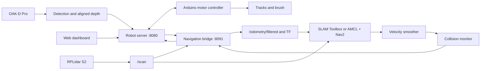

# Software architecture

## Package responsibilities

| Package | Responsibility |
| --- | --- |
| `dwm_core` | Controller state, motion geometry, wheel/gyro odometry and writable paths |
| `dwm_perception` | OAK acquisition, dark-grass candidates, detector assets and YOLO tools |
| `dwm_robot` | HTTP dashboard, detector worker, Arduino telemetry and sole motor writer |
| `dwm_navigation` | ROS TF/odometry, map persistence, localization checks and waypoint goals |
| `dwm_bringup` | Application/lidar launch, SLAM/Nav2 sessions and default configuration |

## Motor ownership

The robot server is the only Arduino serial writer. Navigation requests a bounded
motor session through its localhost HTTP interface. The bridge sends command
velocities with sequence numbers and live lidar points. Direct ROS velocity
publishing does not open Arduino or bypass the server's command checks.

The browser owns a short-lived control lease and sends heartbeats. The ROS
bridge does not keep that browser lease alive independently. Page visibility,
communication age and explicit Stop affect motion in both manual and route modes.

## ROS interfaces

| Interface | Type / direction |
| --- | --- |
| `/scan` | `sensor_msgs/LaserScan`, lidar to navigation |
| `/odometry/filtered` | `nav_msgs/Odometry`, bridge to Nav2/SLAM |
| `/tf` | `odom -> base_footprint`, bridge |
| `/tf_static` | `base_footprint -> laser`, bridge |
| `/map` | `nav_msgs/OccupancyGrid`, SLAM or map server |
| `/initialpose` | `geometry_msgs/PoseWithCovarianceStamped`, bridge to AMCL |
| `/plan` | `nav_msgs/Path`, Nav2 to map display |
| `/cmd_vel_nav` | `geometry_msgs/Twist`, controller/behaviors to smoother |
| `/cmd_vel` | `geometry_msgs/Twist`, smoother to collision monitor |
| `/cmd_vel_safe` | `geometry_msgs/Twist`, collision monitor to bridge |
| `/navigate_to_pose` | `nav2_msgs/action/NavigateToPose`, bridge to Nav2 |

The ROS topic name `/odometry/filtered` refers to the custom planar gyro/wheel
filter. A robot_localization EKF is not part of this implementation.

## Navigation and motion tuning

NavFn uses A* with unknown space excluded. DWB is the local controller; it scores
trajectories using the complete robot footprint. Costmap padding and the direct
swept-body guard use a 3 cm buffer. The collision monitor follows velocity
smoothing in the command chain so a blocked command is not subsequently ramped.

Maximum navigation speed is 0.12 m/s and 0.30 rad/s. Linear acceleration is
0.08 m/s² and normal deceleration is 0.16 m/s². Angular acceleration is
0.22 rad/s² and normal deceleration is 0.30 rad/s². Emergency/stale-command stops
are separate from normal smoothing. DWB samples 20 linear and 41 angular values.

## Map sessions and persistence

The bridge starts one owned SLAM or Nav2 launch process group at a time. The web
page starts and stops sessions; the top-level application launch does not also
start SLAM or Nav2. Named maps use `<name>/map.yaml` and an image. Route drafts
are JSON, bound to their map name and executed in order.

Runtime files live under `DWM_DATA_DIR`, default `~/.local/share/dwm_robot`.
Installed assets, weights and web files are resolved through ament package shares.
This keeps editable settings and map writes out of the installation tree.

## Design decisions and tradeoffs

| Decision | Reason | Tradeoff |
| --- | --- | --- |
| One Arduino writer | Keep hardware ownership and stop behavior in one process | ROS control passes through a localhost HTTP bridge |
| Separate mapping and navigation sessions | Avoid simultaneous SLAM/AMCL map-frame ownership | A session change requires a fresh pose confirmation |
| Full rectangular footprint | Include the rear collection frame during turns | Narrow passages may be rejected even when the track body fits |
| Gyro/wheel yaw fusion | Reduce reliance on magnetic heading and track-slip-prone wheel yaw | Bias and wheel-scale calibration still affect accuracy |
| Latest-frame vision processing | Avoid a growing capture/inference queue | Frames may be dropped under load |
| Separate cleaning and waypoint modes | Keep the demonstrated behaviors independently operable | Automatic clean-and-resume missions remain future work |

## Implementation provenance

Control workers, serial integration, browser control, geometry checks and
waypoint coordination are project code. ROS 2, Nav2, SLAM Toolbox, DepthAI and
Ultralytics are upstream dependencies. NavFn A*, DWB and BoT-SORT are configured
components, not algorithms reimplemented in this repository.

The ROS package layout is a later source reorganization of the working
flat-layout application. The original installed custom bringup package could not
be retrieved; the committed launch files and map-storage module are replacement
implementations based on the recorded interfaces. Their presence is not evidence
that this particular checkout was deployed. The tracker YAML is also a replacement
baseline. Build, runtime integration and physical behavior need validation after
these structural changes.

## References

- [ROS 2 Jazzy](https://docs.ros.org/en/jazzy/)
- [Nav2 configuration](https://docs.nav2.org/jazzy/configuration_and_development/)
- [SLAM Toolbox](https://github.com/SteveMacenski/slam_toolbox)
- [RPLidar ROS driver](https://github.com/Slamtec/rplidar_ros)
- [Ultralytics](https://docs.ultralytics.com/)
