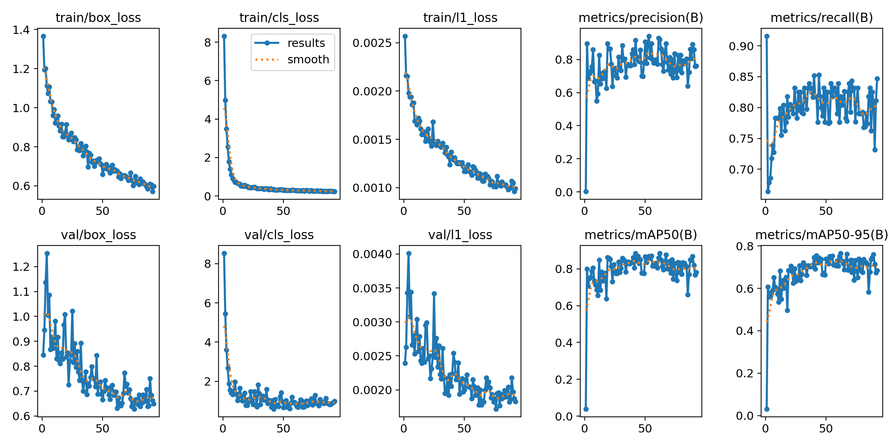
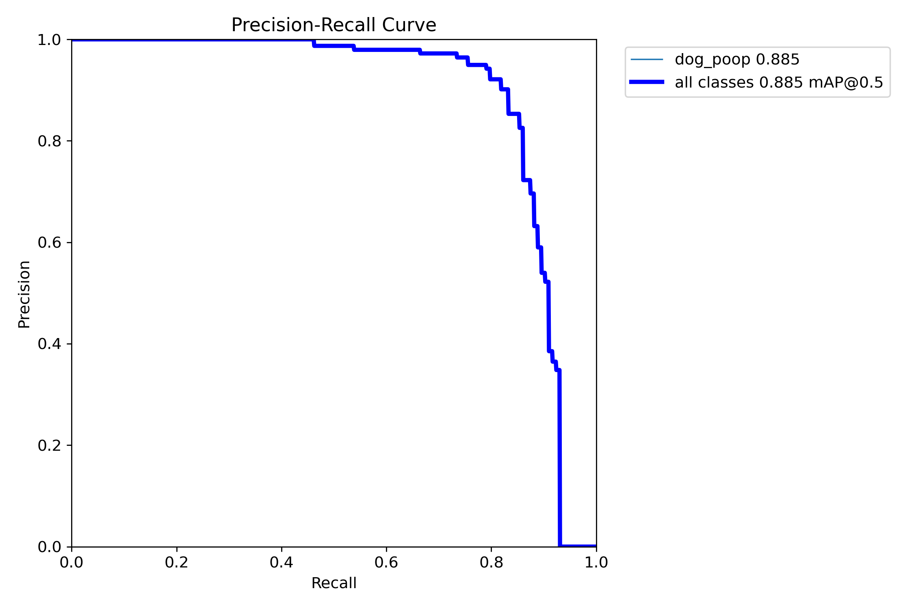
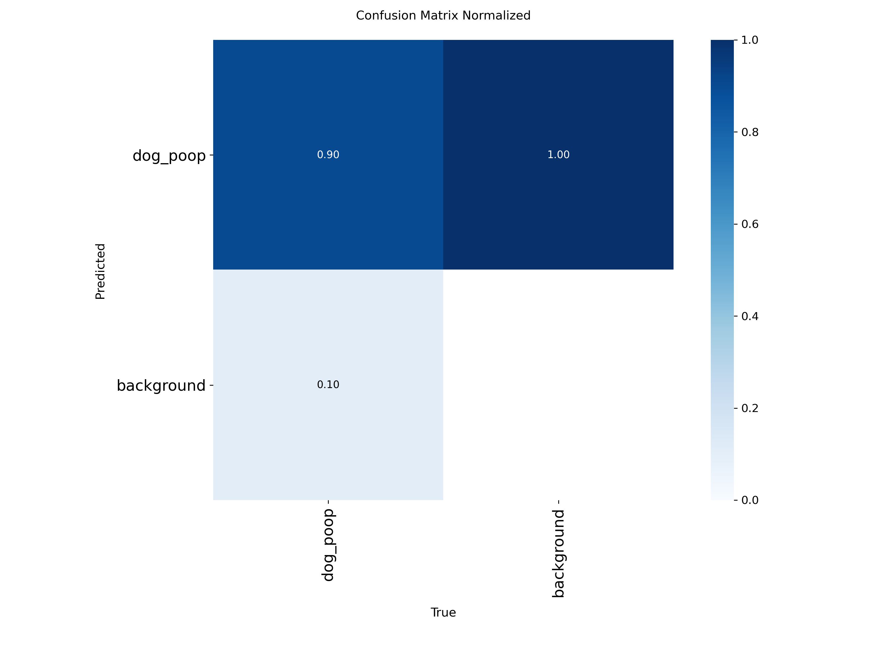

# Perception

## Runtime pipeline

OAK-D Pro supplies synchronized RGB and RGB-aligned depth at 15 FPS. The robot
server processes the latest frame with YOLO26n and BoT-SORT, associates depth
with detections and uses the selected target for approach control. Detector
and target-lock thresholds default to 0.30.

When the main detector returns no target, small dark regions surrounded by
green grass can become **possible poop** candidates. The fallback can also
select shadows, leaves or other dark objects; it is a heuristic, not a second
trained classifier. Candidates still require downstream visibility and depth.

The original deployed tracker YAML was unavailable. The included BoT-SORT
configuration is a replacement baseline with a 60-frame buffer and ReID disabled.

## Model and training evidence

The repository retains one runtime checkpoint, `models/best-v2.pt`, plus compact
evidence from the original `yolo26n_poop` run:

| File | Purpose |
| --- | --- |
| `models/model_info.json` | Architecture, class, checksum and selected validation row |
| `training/yolo26n_poop/args.yaml` | Original training arguments |
| `training/yolo26n_poop/results.csv` | Per-epoch training and validation values |
| `training/yolo26n_poop/results.png` | Loss and metric curves |
| `training/yolo26n_poop/BoxPR_curve.png` | Precision-recall curve |
| `training/yolo26n_poop/confusion_matrix_normalized.png` | Normalized confusion matrix |

Paths in this table are relative to `src/dwm_perception/`. Duplicate checkpoints,
unused exports and batch-preview mosaics are excluded.

The checkpoint is YOLO26n with class 0 `dog_poop`. Its SHA-256 is:

```text
6649b0b3b152767a573edd3119324821e9e6c972f0528c0f157161a0273bd407
```

The original configuration requested 150 epochs with patience 30; the CSV records
92 epochs. The highest recorded mAP50-95 row is epoch 62:

| Metric | Value |
| --- | --- |
| Precision | 0.92049 |
| Recall | 0.81818 |
| mAP50 | 0.88437 |
| mAP50-95 | 0.76505 |

These values were read from the existing CSV. No new evaluation was performed.
They do not quantify robot approach accuracy, pickup success or performance on
unseen outdoor environments. The full dataset and its split definitions are not
included, so this repository alone cannot reproduce the training run exactly.







## Detector commands

Source ROS and the built workspace, then use the CUDA-capable interpreter:

```bash
source /opt/ros/jazzy/setup.bash
source ~/dwm-robot/install/setup.bash

"$DWM_VISION_PYTHON" -m dwm_perception.yolo_tools predict --source /path/to/image.jpg
"$DWM_VISION_PYTHON" -m dwm_perception.yolo_tools validate --data /path/to/data.yaml
"$DWM_VISION_PYTHON" -m dwm_perception.yolo_tools train --data /path/to/data.yaml
```

`config/dataset.example.yaml` documents the required layout. Set its root path
and provide `images/train`, `images/val` and matching YOLO label directories.
The helper defaults to 640 px, seed 42, 150 epochs, patience 30 and automatic
batch sizing. It exposes the main options; the original arguments remain the
reference for the recorded experiment.

An export command is available when needed, but no unused export is committed:

```bash
"$DWM_VISION_PYTHON" -m dwm_perception.yolo_tools export \
  --weights /writable/path/best-v2.pt --format onnx
```

Exports are written beside the checkpoint. TensorRT engines depend on the target
runtime and are excluded from source control.
